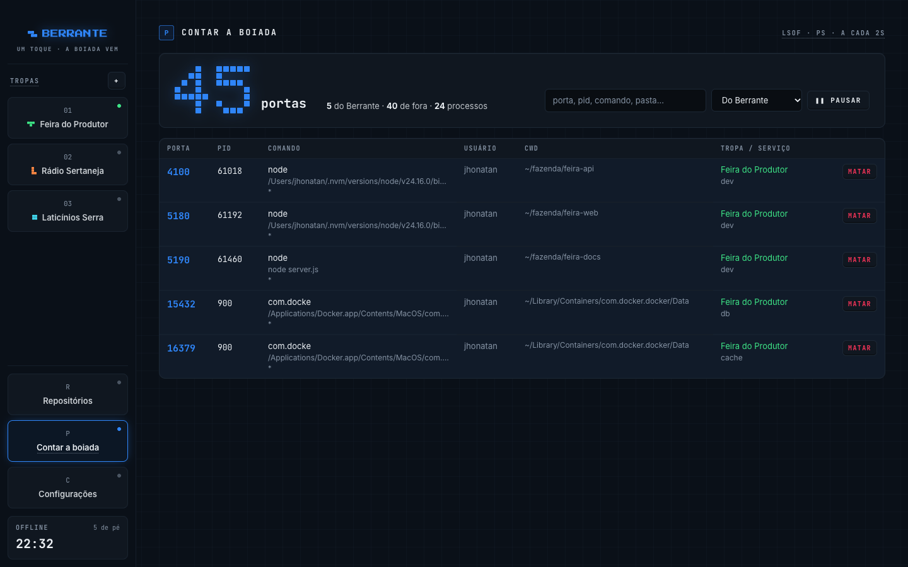
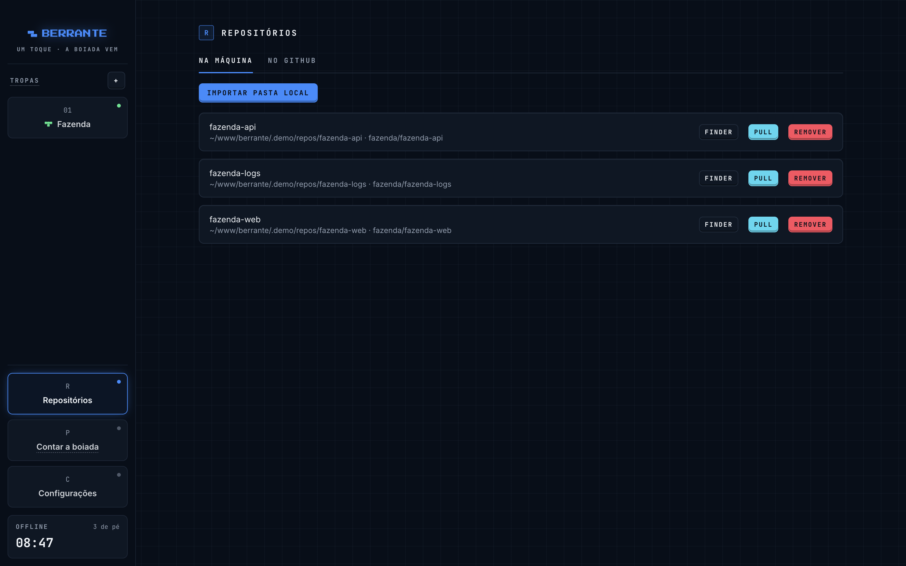
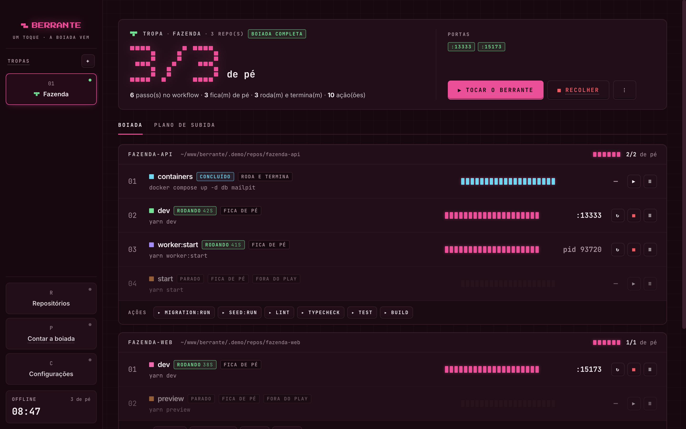

<div align="center">


# Berrante

**Um toque e a boiada vem junto.** Junte os repositórios de um projeto numa **tropa** e suba containers, etapas
de preparo e scripts de dev na ordem certa, com um clique.

[](https://github.com/jhonatanffelipe/berrante/releases/latest)


[**Baixar**](https://github.com/jhonatanffelipe/berrante/releases/latest) ·
[Guia de instalação](docs/guia-instalacao.md) ·
[Novidades](CHANGELOG.md) ·
[Desenvolvimento](docs/desenvolvimento.md)


</div>

## ✨ Destaques

- **Tropas:** um projeto com vários repositórios (backend, web, logs…) que sobem juntos.
- **Workflow de subida:** passos que rodam de cima para baixo, como você faria no terminal. Cada um tem nome, pasta,
  comando, env e quando seguir para o próximo: ao **terminar** (`docker compose up -d`), ao **abrir uma porta**
  (`yarn dev`) ou ao **iniciar** (worker). Se um passo falhar, os seguintes não rodam.
- **Detectado sozinho:** o Berrante lê o lockfile, o `docker-compose.yml`, os scripts do `package.json`, o README e o
  `.env.example` e monta rede → containers → API → workers → front-end. Re-detectar preserva o que você mudou.
- **Tocar o berrante:** sobe tudo na ordem, mostra quantos processos estão de pé, portas, tempo rodando e log ao
  vivo de cada um. **Recolher a boiada** para tudo de forma limpa (`SIGTERM` → `SIGKILL` e `docker compose stop`).
- **Fecha sem derrubar:** ao sair, escolha entre recolher ou manter rodando; na próxima abertura o Berrante reconhece
  os processos que ficaram de pé.
- **Curral:** todos os containers Docker da máquina, com a tropa dona de cada um; pare, suba ou reinicie de dentro
  do Berrante. Na tropa, a aba **Containers** mostra o que os passos `docker compose … up` sobem, serviço a serviço.
- **Contar a boiada:** todas as portas abertas da máquina, com PID, comando e de qual tropa é. Avisa antes de subir
  se alguma porta já estiver ocupada.
- **GitHub integrado:** login pelo `gh` ou por código, lista, clone e pull, com o token guardado cifrado.
- **IA opcional e sob controle:** Claude Code ou Antigravity leem os repositórios em modo somente leitura e sugerem
  um workflow, com o porquê de cada passo; você escolhe o que entra.
- **2FA (TOTP)** para as ações sensíveis, como a IA e encerrar processos de fora.
- **Do seu jeito:** 9 cores de destaque com o fundo tingido pelo tom escolhido, o tema **Drácula** e atalhos de
  teclado para tudo.

## 🖥️ Telas

<table>
  <tr>
    <td width="50%"></td>
    <td width="50%"></td>
  </tr>
  <tr>
    <td align="center"><sub><b>Plano de subida</b> · workflow em passos, pasta, comando e env</sub></td>
    <td align="center"><sub><b>Contar a boiada</b> · portas, PIDs e de qual tropa é cada uma</sub></td>
  </tr>
  <tr>
    <td width="50%"></td>
    <td width="50%"></td>
  </tr>
  <tr>
    <td align="center"><sub><b>Repositórios</b> · clone, pull e importação de pastas</sub></td>
    <td align="center"><sub><b>Configurações</b> · IA, 2FA e aparência</sub></td>
  </tr>
</table>

### Cor de destaque e temas

9 cores de destaque que tingem o fundo com o próprio tom, e o tema pronto **Drácula**, com a paleta oficial.

<table>
  <tr>
    <td width="50%"></td>
    <td width="50%"></td>
  </tr>
  <tr>
    <td align="center"><sub><b>Drácula</b> · tema pronto</sub></td>
    <td align="center"><sub><b>Verde-limão</b></sub></td>
  </tr>
  <tr>
    <td width="50%"></td>
    <td width="50%"></td>
  </tr>
  <tr>
    <td align="center"><sub><b>Laranja</b></sub></td>
    <td align="center"><sub><b>Rosa</b></sub></td>
  </tr>
</table>

> As telas usam a tropa de demonstração **Fazenda** (`fazenda-api`, `fazenda-web` e `fazenda-logs`), montada a partir
> das fixtures de teste por `node scripts/demo-shots.mjs`.

## 📦 Baixar e instalar

Baixe na página da [última versão](https://github.com/jhonatanffelipe/berrante/releases/latest):

| Sistema | Arquivo |
|---|---|
| macOS · Apple Silicon (M1 ou mais novo) | `Berrante-0.2.1-mac-arm64.dmg` |
| macOS · Intel | `Berrante-0.2.1-mac-x64.dmg` |

O app não é assinado, então o macOS pede uma confirmação na primeira abertura. O passo a passo, da instalação à
primeira tropa de pé, está no **[guia de instalação](docs/guia-instalacao.md)**.

> **Só macOS, por enquanto.** As primeiras versões do Berrante rodam apenas no macOS 12 ou mais novo (Apple Silicon
> e Intel). Windows e Linux não são suportados.

## ⌨️ Atalhos

| Atalho | Ação |
|---|---|
| `⌘N` | Nova tropa |
| `⌘↩` | Tocar o berrante |
| `⇧⌘↩` | Recolher a boiada |
| `⌘1` … `⌘9` | Ir para a tropa N |
| `⌥⌘1` / `⌥⌘2` / `⌥⌘3` | Abas Boiada / Plano de subida / Containers |
| `⇧⌘R` | Repositórios |
| `⇧⌘P` | Contar a boiada |
| `⇧⌘D` | Curral (containers) |
| `⌘,` | Configurações |

## 🤠 Vocabulário

| No app | Quer dizer |
|---|---|
| Tropa | Projeto: um grupo de repositórios que sobem juntos |
| Tocar o berrante | Subir tudo (start all) |
| Recolher a boiada | Parar tudo (stop all) |
| Contar a boiada | Ver portas e processos abertos |
| Curral | Containers Docker da máquina |
| De pé | Rodando |

## 🛠️ Desenvolvimento

Electron + React 18 + TypeScript + Tailwind, com o processo principal em Clean Architecture (um use case por
arquivo, ports e adapters para tudo que toca o sistema). Usa **Yarn** (v1) e Node 24.

```bash
yarn install
cp config/.env.example config/.env   # BERRANTE_GITHUB_CLIENT_ID para o login por código
yarn dev                             # app com HMR
yarn test                            # vitest
yarn dist                            # .dmg e .zip do macOS (arm64 e x64) em release/<versão>/
```

Arquitetura, decisões de segurança, testes e como montar uma versão: **[docs/desenvolvimento.md](docs/desenvolvimento.md)**.

## 📋 Versões

As notas de cada versão ficam em [`versions/`](versions/README.md) e no [CHANGELOG](CHANGELOG.md). Os instaladores
ficam anexados aos [Releases](https://github.com/jhonatanffelipe/berrante/releases).
