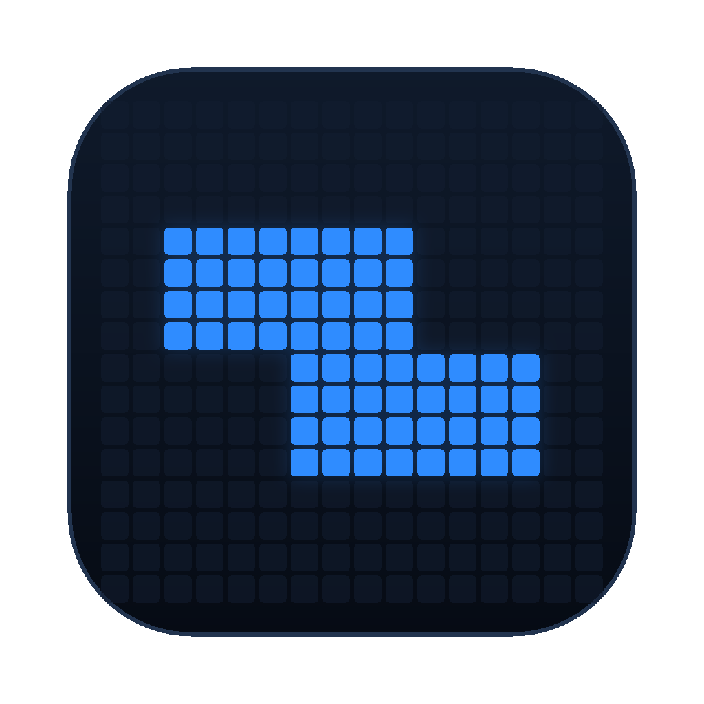
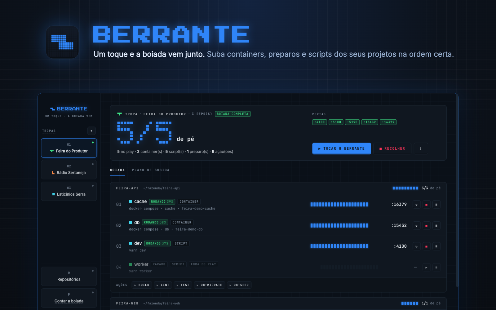
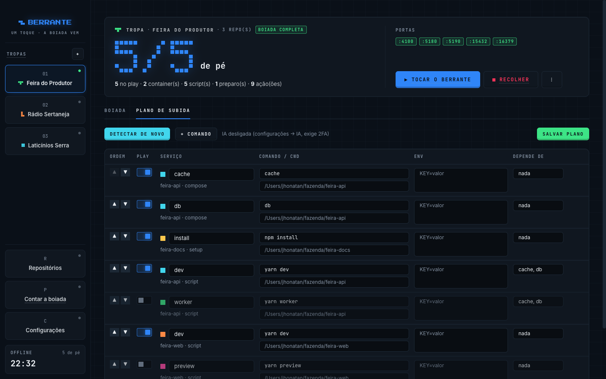
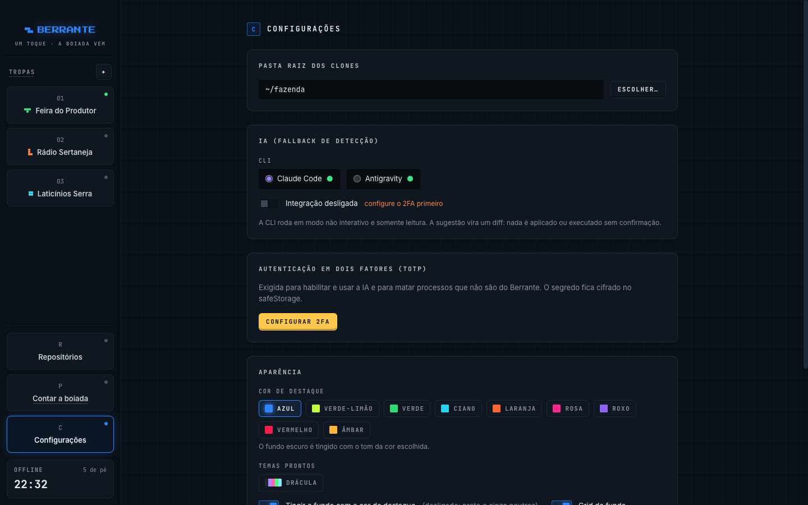
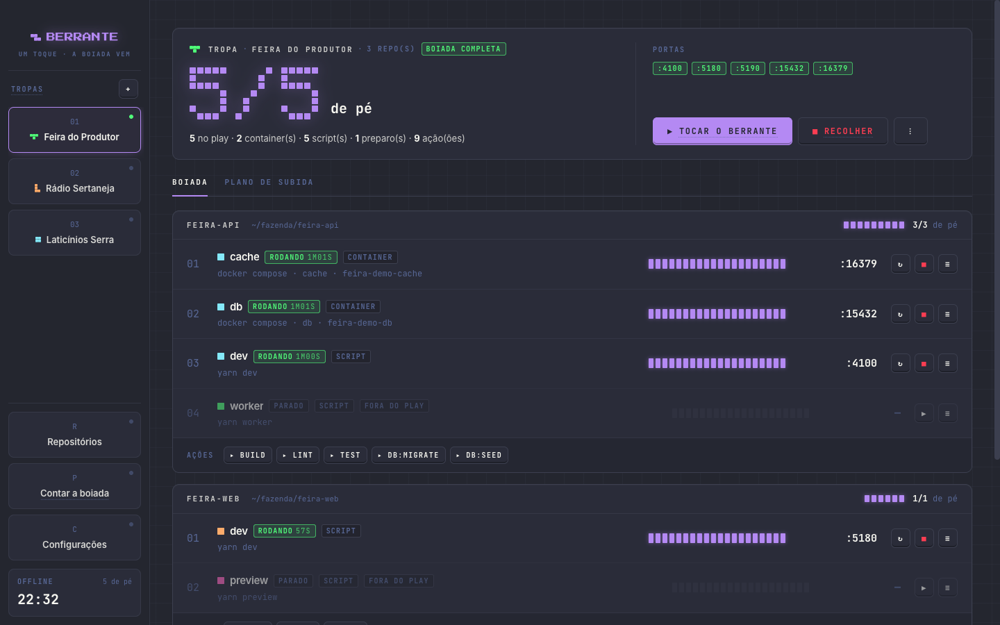
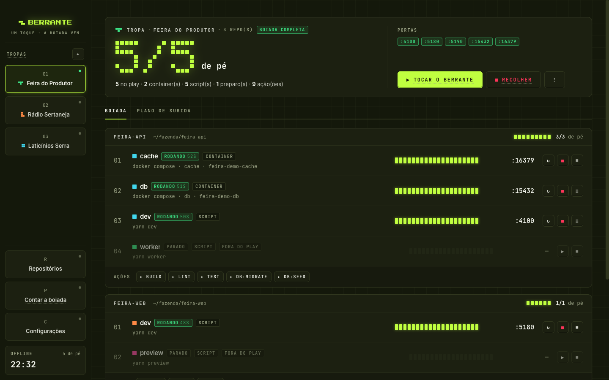
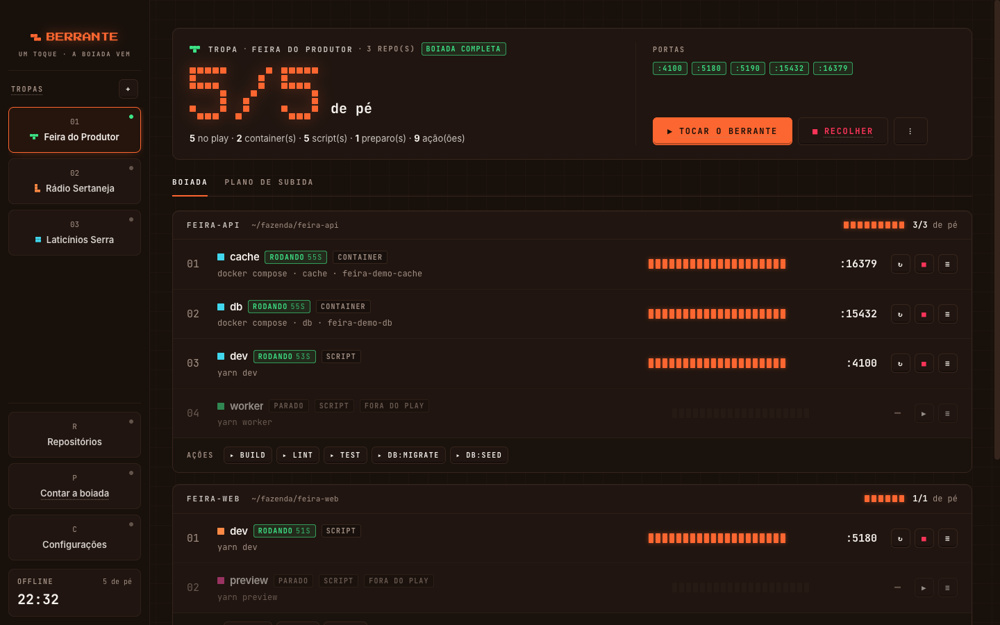

<div align="center">



# Berrante

**Um toque e a boiada vem junto.** Junte os repositórios de um projeto numa **tropa** e suba containers, etapas
de preparo e scripts de dev na ordem certa, com um clique.

[](https://github.com/jhonatanffelipe/berrante/releases/latest)


[**Baixar**](https://github.com/jhonatanffelipe/berrante/releases/latest) ·
[Guia de instalação](docs/guia-instalacao.md) ·
[Novidades](CHANGELOG.md) ·
[Desenvolvimento](docs/desenvolvimento.md)



</div>

## ✨ Destaques

- **Tropas:** um projeto com vários repositórios (backend, web, logs…) que sobem juntos.
- **Plano de subida detectado sozinho:** o Berrante lê o lockfile, o `docker-compose.yml`, os scripts do
  `package.json`, os blocos de shell do README e o `.env.example`, e monta a ordem: containers, preparos (`install`,
  `docker network create`) e serviços. O plano é editável, e re-detectar preserva o que você mudou.
- **Tocar o berrante:** sobe tudo na ordem, mostra quantos serviços estão de pé, portas, tempo rodando e log ao
  vivo de cada um. **Recolher a boiada** para tudo de forma limpa (`SIGTERM` → `SIGKILL` e `docker compose stop`).
- **Fecha sem derrubar:** ao sair, escolha entre recolher ou manter rodando; na próxima abertura o Berrante reconhece
  os processos que ficaram de pé.
- **Contar a boiada:** todas as portas abertas da máquina, com PID, comando e de qual tropa é. Avisa antes de subir
  se alguma porta já estiver ocupada.
- **GitHub integrado:** login pelo `gh` ou por código, lista, clone e pull, com o token guardado cifrado.
- **IA opcional e sob controle:** Claude Code ou Antigravity sugerem ajustes no plano em modo somente leitura, como
  um diff que você aprova item a item.
- **2FA (TOTP)** para as ações sensíveis, como a IA e encerrar processos de fora.
- **Do seu jeito:** 9 cores de destaque com o fundo tingido pelo tom escolhido, o tema **Drácula** e atalhos de
  teclado para tudo.

## 🖥️ Telas

<table>
  <tr>
    <td width="50%"></td>
    <td width="50%"></td>
  </tr>
  <tr>
    <td align="center"><sub><b>Plano de subida</b> · detectado, editável, com dependências</sub></td>
    <td align="center"><sub><b>Contar a boiada</b> · portas, PIDs e de qual tropa é cada uma</sub></td>
  </tr>
  <tr>
    <td width="50%"></td>
    <td width="50%"></td>
  </tr>
  <tr>
    <td align="center"><sub><b>Repositórios</b> · clone, pull e importação de pastas</sub></td>
    <td align="center"><sub><b>Configurações</b> · IA, 2FA e aparência</sub></td>
  </tr>
</table>

### Cor de destaque e temas

9 cores de destaque que tingem o fundo com o próprio tom, e o tema pronto **Drácula**, com a paleta oficial.

<table>
  <tr>
    <td width="50%"></td>
    <td width="50%"></td>
  </tr>
  <tr>
    <td align="center"><sub><b>Drácula</b> · tema pronto</sub></td>
    <td align="center"><sub><b>Verde-limão</b></sub></td>
  </tr>
  <tr>
    <td width="50%"></td>
    <td width="50%"></td>
  </tr>
  <tr>
    <td align="center"><sub><b>Laranja</b></sub></td>
    <td align="center"><sub><b>Rosa</b></sub></td>
  </tr>
</table>

> As telas usam tropas de demonstração (Feira do Produtor, Rádio Sertaneja e Laticínios Serra) com repositórios
> fictícios.

## 📦 Baixar e instalar

Baixe na página da [última versão](https://github.com/jhonatanffelipe/berrante/releases/latest):

| Sistema | Arquivo |
|---|---|
| macOS · Apple Silicon (M1 ou mais novo) | `Berrante-0.1.0-mac-arm64.dmg` |
| macOS · Intel | `Berrante-0.1.0-mac-x64.dmg` |
| Windows 10/11 · x64 | `Berrante-Setup-0.1.0-win-x64.exe` |
| Windows 11 · ARM | `Berrante-Setup-0.1.0-win-arm64.exe` |
| Linux · Debian/Ubuntu | `Berrante-0.1.0-linux-amd64.deb` / `-linux-arm64.deb` |
| Linux · qualquer distro | `Berrante-0.1.0-linux-x86_64.AppImage` / `-linux-arm64.AppImage` |

O instalador do Windows é um assistente: dá para escolher entre instalar **só para você** ou **para todos os
usuários** (em `Arquivos de Programas`) e trocar a pasta. Ele cria atalhos no Menu Iniciar e na Área de Trabalho, e
o app aparece em **Configurações → Aplicativos** para desinstalar.

Os apps não são assinados, então o macOS e o Windows pedem uma confirmação na primeira abertura. O passo a passo,
da instalação à primeira tropa de pé, está no **[guia de instalação](docs/guia-instalacao.md)**.

> **Situação nesta versão:** o **macOS** é o alvo principal e tem tudo funcionando. O **Linux** usa as mesmas
> ferramentas e deve funcionar igual, mas foi pouco testado. No **Windows** o app instala, abre, faz login, clona e
> detecta o plano, mas ainda **não sobe serviços nem lista portas**: isso vem com o suporte à WSL.

## ⌨️ Atalhos

| Atalho (macOS) | Windows/Linux | Ação |
|---|---|---|
| `⌘N` | `Ctrl+N` | Nova tropa |
| `⌘↩` | `Ctrl+Enter` | Tocar o berrante |
| `⇧⌘↩` | `Ctrl+Shift+Enter` | Recolher a boiada |
| `⌘1` … `⌘9` | `Ctrl+1` … `Ctrl+9` | Ir para a tropa N |
| `⌥⌘1` / `⌥⌘2` | `Ctrl+Alt+1` / `Ctrl+Alt+2` | Abas Boiada / Plano de subida |
| `⇧⌘R` | `Ctrl+Shift+R` | Repositórios |
| `⇧⌘P` | `Ctrl+Shift+P` | Contar a boiada |
| `⌘,` | `Ctrl+,` | Configurações |

## 🤠 Vocabulário

| No app | Quer dizer |
|---|---|
| Tropa | Projeto: um grupo de repositórios que sobem juntos |
| Tocar o berrante | Subir tudo (start all) |
| Recolher a boiada | Parar tudo (stop all) |
| Contar a boiada | Ver portas e processos abertos |
| De pé | Rodando |

## 🛠️ Desenvolvimento

Electron + React 18 + TypeScript + Tailwind, com o processo principal em Clean Architecture (um use case por
arquivo, ports e adapters para tudo que toca o sistema). Usa **Yarn** (v1) e Node 24.

```bash
yarn install
cp config/.env.example config/.env   # BERRANTE_GITHUB_CLIENT_ID para o login por código
yarn dev                             # app com HMR
yarn test                            # vitest
yarn dist                            # instaladores de macOS, Windows e Linux em release/<versão>/
```

Arquitetura, decisões de segurança, testes e como montar uma versão: **[docs/desenvolvimento.md](docs/desenvolvimento.md)**.

## 📋 Versões

As notas de cada versão ficam em [`versions/`](versions/README.md) e no [CHANGELOG](CHANGELOG.md). Os instaladores
ficam anexados aos [Releases](https://github.com/jhonatanffelipe/berrante/releases).
